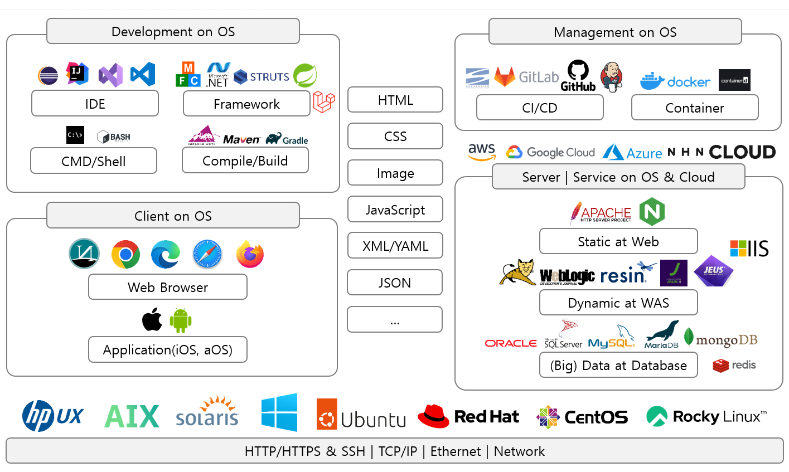

<!--
- 
- 
- 
-->
# com.plutozone

> YOU ARE STRICTLY PROHIBITED TO COPY, DISCLOSE, DISTRIBUTE, MODIFY OR USE THIS DOCUMENT IN PART OR AS A WHOLE WITHOUT THE PRIOR WRITTEN CONSENT OF PLUTOZONE.COM. 
PLUTOZONE.COM OWNS THE INTELLECTUAL PROPERTY RIGHTS IN AND TO THIS DOCUMENT. 
COPYRIGHT © 2005 PLUTOZONE.COM ALL RIGHTS RESERVED
***
> plutozone.com의 사전 서면 동의 없이 본 문서의 전부 또는 일부를 복사, 공개, 배포, 수정하거나 사용하는 행위는 엄격히 금지됩니다. 
본 문서에 대한 지적재산권은 plutozone.com이 보유하고 있습니다. 
Copyright © 2005 plutozone.com All Rights Reserved
***

## Overview
- Our knowledge and wisdom are learned from someone and should be given to the next person.
- This article introduces some technical aspects of information technology and was written based on the author's subjective opinion. Therefore the author is not legally responsible for any problems that may arise during citation or application and the information may be changed without notice.
- `Markdown + Example or Demo Source + Image + PDF for IT(Information Technology)`
- `Open Source exists in a other Repository`

## Document
### [Information Technology(IT) 기술 문서](./com/plutozone/knowledge/README.md)

## Source
### [com.plutozone.knowledge](https://github.com/myPlutoZone/com.plutozone.knowledge "IT 기술 문서")

### [com.plutozone.openMalls](https://github.com/myPlutoZone/com.plutozone.openMalls "Spring Web and MariaDB for Manager + Product + Member + Membership + Message + ...")

### [com.plutozone.demo.springBoot](https://github.com/myPlutoZone/com.plutozone.demo.springBoot "Demo for SpringBoot by IntelliJ + Maven")

### [com.plutozone.demo.spring](https://github.com/myPlutoZone/com.plutozone.demo.spring "Demo for Spring + Maven")

## History
- 2025-04-21 [REPORT] Renewal end!
- 2024-10-16 [REPORT] Renewal begins!
- 2024-04-30 [UPDATE] Repository Name(The previous repository name was com.plutozone.education)
- 2023-09-29 [UPDATE] Repository Name(The previous repository name was com.plutozone.programming.java)
- 2023-09-28 [INSERT] messenger Package
- 2023-08-31 [INSERT] AutoReservation.java
- 2023-08-23 [CREATE] Initial Release

## Reference
- Comment in only ..., 개선(BETTER), 추가(INSERT), 결함(FAULT), 수정(UPDATE), 삭제(DELETE), 참고(REPORT) for Push
- Generate a token for an Eclipse Password(Profile > Settings > Developer Settings > Personal access tokens (classic) at GitHub)