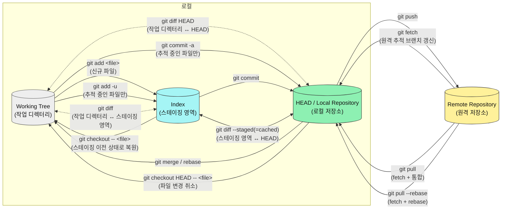

# com.plutozone.knowledge.development.Git


## Overview
| NO | 공식 용어(일반적 표현) | 번역 | 용도 | 관련 명령어 |
| :---: | :--- | :---: | :--- | :--- |
| 1 | Working Tree(Working Directory) | 작업 트리(`작업 디렉터리`) | 실제 파일 작업 공간 | `git status`, `git diff` |
| 2 | Index(Staging Area) | 인덱스(`스테이징 영역`) | 커밋 및 이력을 준비하는 영역 | `git add`, `git diff --staged(=cached)` |
| 3 | Local Repository | `로컬 저장소` | 커밋 및 이력을 저장하는 로컬 저장소 | `git commit`, `git log` |
| 4 | Remote Repository | `원격 저장소` | 공유할 수 있는 원격 저장소 | `git push`, `git pull`, `git fetch` |

| 주요 명령어 | 동작 | 설명 |
| :--- | :--- | :--- |
| `git init` | 저장소 초기화 | 현재 디렉터리를 Git 저장소로 초기화 |
| `git add .` | Working Tree → Staging Area | 작업 트리의 변경 사항(신규 파일 포함)을 스테이징 영역에 등록 |
| `git commit` | Staging Area → Local Repository | 스테이징된 변경 사항을 로컬 저장소에 기록 |
| `git push` | Local Repository → Remote Repository | 로컬 커밋을 원격 저장소로 전송 |
| `git fetch` | Remote Repository → 원격 추적 정보 | 원격 변경 사항을 가져오되 현재 작업 브랜치에는 자동 통합하지 않음 |
| `git pull` | Remote Repository → Local Repository (통합) | 원격 변경 사항을 가져와 현재 브랜치에 통합 |


## Temp
- reset(현재 버전을 삭제하고 이전 버전으로) vs. revert(현재 버전을 남기면서 신규 버전 생성)
- restore
- git flow is process or tools
- merge vs. rebase 그러나 결과는 같다.
- `Untracked files` vs. `Changes to be committed`
- 명령어
	| 명령어 | 데이터 흐름 및 동작 |
	| :--- | :--- |
	| `git add <file>` | 작업 디렉터리 → 스테이징 영역. 지정한 파일의 변경 사항을 스테이징합니다. |
	| `git add -u` | 추적 중인 파일의 수정 및 삭제 사항을 스테이징합니다. 새 파일은 포함하지 않습니다. |
	| `git commit` | 스테이징 영역 → 로컬 저장소. 스테이징된 변경 사항을 커밋합니다. |
	| `git commit -a` | 추적 중인 수정·삭제 파일을 자동 스테이징한 후 커밋합니다. 새 파일은 포함하지 않습니다. |
	| `git push` | 로컬 저장소 → 원격 저장소. 로컬 커밋을 원격 브랜치에 전송합니다. |
	| `git fetch` | 원격 저장소의 객체와 참조를 가져오고 원격 추적 브랜치를 갱신합니다. 현재 브랜치에는 자동 통합하지 않습니다. |
	| `git pull` | `fetch` 후 현재 브랜치에 원격 변경 사항을 통합합니다. 기본 통합 방식은 설정에 따라 달라질 수 있습니다. |
	| `git pull --rebase` | `fetch` 후 로컬 커밋을 원격 변경 사항 위로 재배치합니다. |
	| `git checkout HEAD -- <file>` | 지정 파일을 `HEAD` 기준으로 복원합니다. 작업 디렉터리의 변경 사항이 사라질 수 있습니다. |
	| `git checkout -- <file>` | 지정 파일을 인덱스 기준으로 복원합니다. 스테이징된 변경 사항은 유지됩니다. |
	| `git diff` | `작업 디렉터리`와 `스테이징 영역` 사이의 차이 확인 |
	| `git diff HEAD` | `작업 디렉터리`와 `HEAD` 커밋 사이의 차이 확인 |
	| `git diff --cached` | `스테이징 영역`과 `HEAD` 커밋 사이의 차이 확인 |
- 최신 Git 사용 시 권장 사항
	| 목적 | 권장 명령어 | 설명 및 주의 사항 |
	| :--- | :--- | :--- |
	| 파일 변경 스테이징 | `git add <file>` | 지정한 파일의 변경 사항을 스테이징합니다. |
	| 추적 중인 파일 스테이징 | `git add -u` | 추적 중인 파일의 수정 및 삭제 사항을 스테이징합니다. |
	| 작업 디렉터리 변경 취소 | `git restore <file>` | 인덱스에 저장된 내용으로 작업 디렉터리의 파일을 복원합니다. |
	| 스테이징 취소 | `git restore --staged <file>` | 인덱스에서 스테이징을 해제합니다. 작업 디렉터리의 변경 사항은 유지됩니다. |
	| 파일을 마지막 커밋 기준으로 복원 | `git restore --source=HEAD --staged --worktree <file>` | 인덱스와 작업 디렉터리를 `HEAD` 기준으로 복원합니다. 해당 파일의 변경 사항이 사라질 수 있습니다. |
	| 브랜치 전환 | `git switch <branch>` | 지정한 브랜치로 전환합니다. |
	| 원격 변경 사항 가져오기 | `git fetch` | 원격 추적 브랜치를 갱신하며 현재 브랜치에는 자동 통합하지 않습니다. |
	| 원격 변경 사항 확인 | `git log HEAD..@{upstream}` | 현재 브랜치에는 없고 업스트림 브랜치에만 있는 커밋을 확인합니다. 업스트림이 설정되어 있어야 합니다. |
	| 원격 변경 사항 비교 | `git diff HEAD..@{upstream}` | 현재 `HEAD`와 업스트림 브랜치의 파일 내용 차이를 확인합니다. |
	| 원격 변경 사항 병합 | `git pull --no-rebase` | 원격 변경 사항을 가져와 병합합니다. |
	| 원격 변경 사항 재배치 | `git pull --rebase` | 원격 변경 사항 위로 로컬 커밋을 재배치합니다. |
	| 변경 사항 확인 | `git diff` | 작업 디렉터리와 인덱스 사이의 차이를 확인합니다. |
	| 커밋 전 변경 사항 확인 | `git diff --cached` | 다음 커밋에 포함될 스테이징된 변경 사항을 확인합니다. |
	| 추적 중인 파일만 빠르게 커밋 | `git commit -a -m "메시지"` | 추적 중인 수정·삭제 파일을 자동 스테이징하고 커밋합니다. 새 파일은 포함되지 않습니다. |
- Git 영역별 비교 명령어
	| 명령어 | 비교 대상 | 확인할 내용 |
	| :--- | :--- | :--- |
	| `git diff` | 작업 디렉터리 ↔ 인덱스 | 스테이징하지 않은 변경 사항 |
	| `git diff --cached` | 인덱스 ↔ `HEAD` | 스테이징했지만 커밋하지 않은 변경 사항 |
	| `git diff HEAD` | 작업 디렉터리 ↔ `HEAD` | 마지막 커밋 이후 작업 디렉터리의 전체 변경 사항 |
	| `git diff HEAD..origin/main` | 현재 `HEAD` ↔ `origin/main` | 현재 커밋과 원격 추적 브랜치 사이의 파일 내용 차이 |
	| `git log HEAD..@{upstream}` | 현재 브랜치 ↔ 업스트림 브랜치 | 업스트림에만 존재하는 커밋 |
	| `git status` | 작업 디렉터리 및 인덱스 상태 | 수정, 스테이징, 미추적 파일 및 브랜치 상태 |


## Version & Branch
> Git의 기능은 버전(변경) 관리다.
```bash
$ git init					# 저장소 초기화(=git init . vs. git init [FOLDER])
$ git status				# show working tree status
$ git add [FILE]			# add [FILE] to staging area
$ git add .					# add all to staging area
$ git add src
$ git commit				# create version(=history) with editor
$ git commit -m "Message"	# create version(=history) with message
$ git commit -am "Message"	# create version(=history) + add(except untracted) with message
$ git log					# show version
$ git log --stat			# show version statics
$ git log -p				# show version with the changes(diffs)
$ git diff					# show change
$ git checkout  [ID]		# change the working tree to a specific version(Checkout is to move HEAD=my version at current branch)
# reset(=delete version) vs. revert(=no delete=new version of before version by one step
$ git reset --hard [ID]		# delete a specific version
$ git revert [ID]			# revert without deleting(=reset) the version
```


## Backup & Restore
> Git를 통해 백업과 복원을 할 수 있다.


## Collaboration
> Git은 협업을 지원한다.


## Tip
- 캐쉬(cache) 제거로 문제 해결
	- gitignore가 제대로 적용되지 않아 등록한 파일이 자꾸 changes로 올라오거나 최악의 경우 conflict 를 유발할 수 있음
	- 대부분의 경우 git의 캐시가 문제 원인이므로 아래 명령어로 캐시를 전부 삭제 후 다시 add, commit을 진행하면 해결됨
		```bash
		git rm -r --cached .
		git add .
		git commit -m "fixed .gitignore issue: clear cache"
		git push
		```
- 처음만 올리고 이후 변경은 무시하고 싶다면
	- 방안 1) assume-unchanged
		```bash
		$ git update-index --assume-unchanged config.json				# 로컬에서만 무시
		$ git update-index --no-assume-unchanged config.json			# 로컬에서만 무시 해제
		```
	- 방안 2) skip-worktree
		```bash
		$ git update-index --skip-worktree config.json					# 워킹 트리에서 무시
		$ update-index --no-skip-worktree config.json					# 워킹 트리에서 무시 해제
		```
	- 방안 3) 용도에 따른 설정 파일 템플릿 사용(권장)
		```text
		.env.example	: Git에 저장
		.env.local		: .gitignore에 추가
		.env			: .gitignore에 추가
		```
- .gitignore 파일은 1개만 그리고 루트에 있어야 한다.