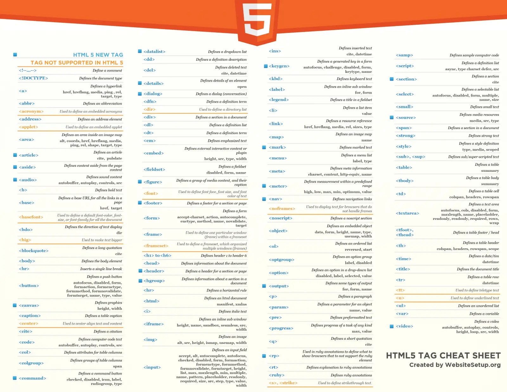
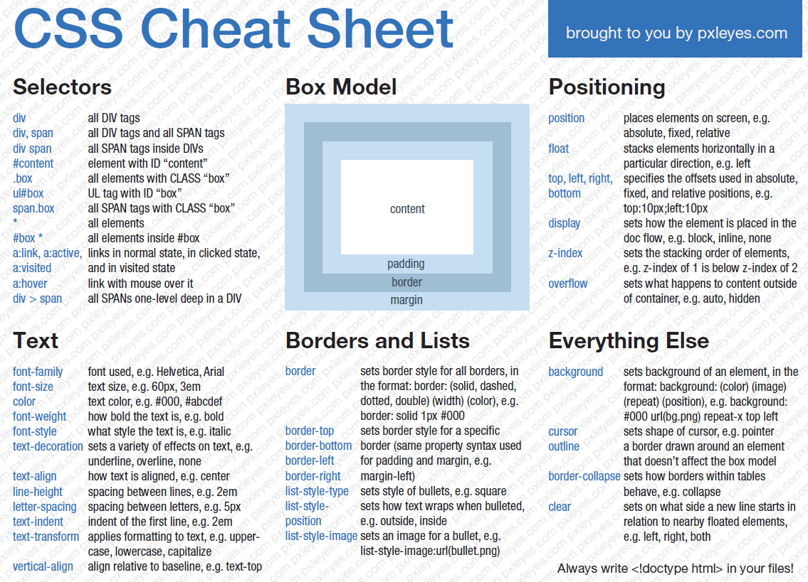
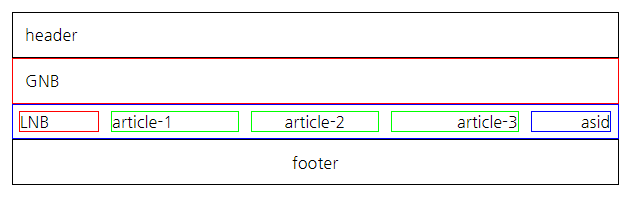
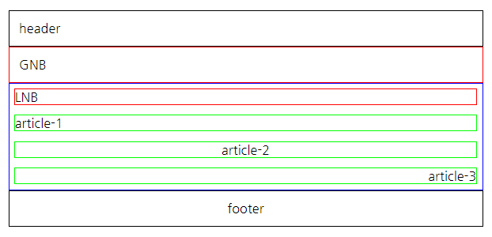

# com.plutozone.knowledge.language.HTML


## Introduction to HTML, CSS, JavaScript(jQuery) and Front Framework
- HTML + CSS + JavaScript는 `정적 리소스(Static Resource)`이며 `웹 브라우저(Web Browser)`에서 실행
- `My JavaScript Library` vs. `jQuery` vs. `React, AngularJS, Vue.js, …`
- `Front UI Framework`(예: Bootstrap, ...) vs. `Front Development Framework`(예: React, ...)
- `Backend vs. Frontend` and `Publisher vs. Developer`
- 서비스 및 관리자 화면 설계서(SB=Story Board)와 구현


## Contents
1. [HTML 기반의 웹 화면 설계 및 구현](#1-html-기반의-웹-화면-설계-및-구현)
2. [반응형 웹(Responsive Web) 설계 및 구현](#2-반응형-웹responsive-web-설계-및-구현)
3. [고객 편리성 제공 화면을 위한 설계 및 구현](#3-고객-편리성-제공-화면을-위한-설계-및-구현)
4. 참고


## 1. HTML 기반의 웹 화면 설계 및 구현
### 1-1. 화면 설계
- UI(User Interface)
	- CLI(Command Line Interface, 명령어 라인 인터페이스)
	- GUI(Graphical User Interface, 그래픽 사용자 인터페이스)
	- NUI(Natural User Interface, 자연어 사용자 인터페이스)
- 요구 사항을 기반으로 `화면 설계 표준 정의`(로그인, 메인, 페이지 등에 대한 화면 내용, 이동 등 포함)
- 요구 사항을 기반으로 `화면 설계서(SB, Story Board) 작성`(프로젝트 수행을 위한 간략한 용어 및 기능 등 포함)
- 필요 시 화면을 구현하기 위해 순서도(Flow Chart) 또는 유스케이스(Use Case) 작성(예: 로그인)
- [화면 설계 및 순서도 작성 도구들](../utility/tool.md#3-1-ui-or-sbstory-board)

### 1-2. 메뉴 구조
- 요구 사항 및 화면 설계서를 기반으로 메뉴 구조도(=사이트 맵-Site Map, 정보 구조-Information Architecture) 작성

### 1-3. 개발 표준
- 웹 화면 개발 표준
	- W3C(World Wide Web Consortium)
	- KWCAG(Korea Web Content Accessibility Guidelines, 한국형 웹 콘텐츠 접근성 지침)
	- 전자정부 웹 표준
- 웹의 3요소(표준, 접근성, 호환성)

### 1-4. 화면 구현
- Server vs. Client and Web Site vs. Web Page
	- 웹 서버(Web Server)의 종류(예: Apache, Nginx, IIS, ...)와 구축
	- 웹 클라이언트(Web Client=Web Browser)의 종류(예: Chrome, Edge, ...)와 특징 그리고 호환성
	- 웹 페이지 개발 도구의 종류(예: VS Code, notepad, vi, nano, ...)와 설치
	-  웹 페이지(hello.html) 개발 후 `웹 서버로 실행` vs. `파일로 실행`
- Web Server(WS) vs. Web Application Server(WAS)
- `Cheat Sheet` for `HTML`, `CSS` at Google Image(https://www.google.com/imghp?hl=ko&ogbl)
	
	
- HTML(HyperText Markup Language)
	- 개요와 특징
	- 구조
		```html
		<!DOCTYPE html>
		<html>
		<head>
			<title></title>
		</head>
		<body>
		</body>
		</html>
		```
	- [태그(Tag)](/WebContent/knowledge/language/html/html.html)
		- a
		- p
		- br
		- img
		- table
		- form
		- input(text, password, radio, checkbox, button, submit, hidden)
		- select
		- textarea 등
	- [시맨틱 태그(Semantic Tag)](/WebContent/knowledge/language/html/semantic.html)
	- [레이아웃(Layout)](./css.md)
		
		
- [CSS(Cascade Style Sheet)](./css.md)
	- 개요와 특징
	- 구조
	- 선택자(Selector)
		- Universal(*)
		- Tag(<?>)
		- Class(.)
		- ID(#)
		- 기타
			| 선택자 | 설명 |
			| :--- | --- |
			| `.parent > p` | 부모 바로 아래 자식 `<p>`만 선택 |
			| `.parent p` | 부모 내부 모든 하위 `<p>`들 선택 |
			| `.parent + p` | `.parent` 바로 다음 형제 `<p>`만 선택 |
			| `.parent ~ p` | `.parent` 뒤에 모든 형제 `<p>`들 선택 |
	- 속성(Attribute)과 Value(값)
		- font-family
		- font-size
		- color 등
	- 레이아웃(Layout)의 역사(table, position, float, flex)
- [JavaScript](./javascript.md)
	- 개요 및 특징
	- 구조
		- <script>...</script>
		- <script src="common.js"></script>
	- 문법
	- HTML 이벤트(onLoad, onClick, ...) 처리
	- JavaScript를 사용하여 HTML DOM(Document Object Model)를 제어(해당 페이지에 HTML, CSS, 이벤트를 추가, 수정, 삭제 등)
		```mermaid
		graph TD
			A["Element(Root)<br/><b>&lt;html&gt;</b>"]

			A --> B["Element<br/><b>&lt;head&gt;</b>"]
			A --> C["Element<br/><b>&lt;body&gt;</b>"]

			B --> D["Element<br/><b>&lt;title&gt;</b>"]
			B --> E["Element<br/><b>&lt;script&gt;</b>"]

			C --> F["Element<br/><b>&lt;h1&gt;</b>"]
			C --> G["Element<br/><b>&lt;p&gt;</b>"]

			D --> H(["Text Node<br/>&quot;페이지 제목&quot;"])
			F --> I(["Text Node<br/>&quot;구현 예&quot;"])
			G --> J(["Text Node<br/>&quot;변경 전&quot;"])

			style A fill:#fff,stroke:#333,color:#222
			style B fill:#fff,stroke:#333,color:#222
			style C fill:#fff,stroke:#333,color:#222
			style D fill:#fff,stroke:#333,color:#222
			style E fill:#fff,stroke:#333,color:#222
			style F fill:#fff,stroke:#333,color:#222
			style G fill:#fff,stroke:#333,color:#222
			style H fill:#fff,stroke:#333,color:#222
			style I fill:#fff,stroke:#333,color:#222
			style J fill:#fff,stroke:#333,color:#222
		```

### 1-4. 화면 검증
- HTML by validator.w3.org + CSS by https://jigsaw.w3.org/css-validator or https://css-validator.org/validator.ko.html
- 테스트 케이스 작성 그리고 단위 테스트 또는 통합 테스트

### 1-5. 기타
- HTML의 가독성
- CSS, JavaScript의 가독성과 최적화(min 등) 그리고 보안(난독화 등)


## 2. 반응형 웹(Responsive Web) 설계 및 구현
### 반응형 웹이란?
- HTML + CSS + JavaScript

### 설계와 구현
- [한 땀 한 땀(hand-crafting the code)](./css.md)
- 프론트엔드 프레임웍 기반
- 유료 또는 무료 템플릿(순수 또는 프론트엔드 프레임웍) 기반
- 솔루션 기반


## 3. 고객 편리성 제공 화면을 위한 설계 및 구현
### 메인
### 로그인
### 목록
### 등록 폼 및 등록
### 보기
### 수정 폼 및 수정
### 삭제(처리)


## 4. 참고
- 정보통신 > 정보기술 > 정보기술개발 > 응용SW엔지니어링 > 화면 설계 or `화면 구현` at https://ncs.go.kr